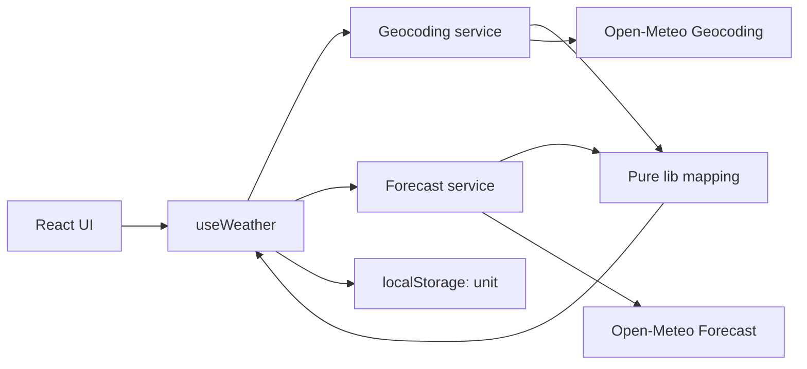
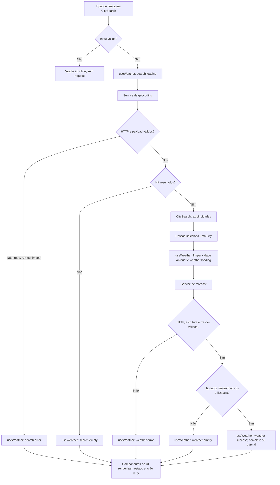

# Plano Técnico: Weather App

## Architecture

Aplicação cliente React, sem backend próprio, dividida em quatro camadas unidirecionais:

- **components:** apresentação e interação; recebem dados, estado e callbacks por props, sem chamar APIs nem acessar armazenamento.
- **hooks:** orquestração do fluxo, estado da tela, seleção de cidade, cancelamento de chamadas obsoletas e preferência de unidade.
- **services:** I/O com a Open-Meteo; montam URLs, aplicam timeout, verificam status HTTP e entregam payloads para normalização.
- **lib:** funções puras para validar/normalizar payloads, mapear modelos, converter temperaturas, avaliar frescor e traduzir códigos WMO.

Dependências permitidas: `components -> hooks`; `hooks -> services + lib`; `services -> lib + types`; `lib -> types`. `components` não importa `services`; `lib` não acessa rede, React, relógio global nem `localStorage`.



A busca retorna localidades. A seleção de uma localidade inicia a consulta meteorológica. Não há servidor, autenticação, geolocalização automática, cache ou polling (RF-01, RF-02, RF-06). Essa fronteira permite testar funções puras sem mocks, serviços com `fetch` controlado, hooks com serviços simulados e componentes pelas props e interações.

## Tech Stack

- **TypeScript strict:** contratos para respostas externas e modelo de domínio.
- **React + Vite:** aplicação web cliente e desenvolvimento/build (RF-01 a RF-06).
- **Tailwind CSS:** estilos responsivos para larguras de 320 a 1920 CSS px (RF-05, RNF-01).
- **Vitest + Testing Library:** testes unitários e de componentes; **Playwright:** fluxos E2E e viewports especificados.
- **pnpm:** instalação e scripts conforme o repositório.
- **Biome:** lint e formatação.
- **Sem biblioteca global de estado ou camada de cache:** estado de uma única tela cabe em React; chamadas são explícitas e sem polling (RF-06).

## Project Structure

```text
src/
  components/
    WeatherApp.tsx        # Composição da página; consome useWeather
    CitySearch.tsx        # Campo e resultados; props e callbacks
    CurrentWeather.tsx    # Condições atuais e ação Atualizar
    ForecastList.tsx      # Previsão diária
    UnitToggle.tsx        # Seleção Celsius/Fahrenheit
  hooks/
    useWeather.ts         # Estado e orquestração do fluxo
  services/
    openMeteo.ts          # HTTP, URLs, parâmetros e timeouts
  lib/
    openMeteoMapper.ts    # Validação/normalização pura de payload -> domínio
    temperature.ts        # Conversão e formatação pura de temperatura
    weatherCodes.ts       # Códigos WMO -> rótulos pt-BR
    freshness.ts          # Validação pura de horário com now/offset injetados
  types/
    openMeteo.ts          # Tipos de payloads externos
    weather.ts            # City, CurrentWeather, ForecastDay, WeatherData, Unit e estados
```

Responsabilidades: `components` renderiza e emite eventos; `hooks` combina serviços, estado de carregamento/erro/seleção e preferência de unidade; `services` é a única camada com `fetch`; `lib` contém funções determinísticas sem efeitos colaterais; `types` define os contratos. Manter um componente por arquivo e não criar camada de repositório, context global ou biblioteca de estado para esta única tela.

Testabilidade por fronteira: `lib` é testado com entradas e saídas diretas; `services` usa `fetch` controlado para URL, timeout e payloads; `hooks` usa serviços simulados para sequenciamento, retry e respostas obsoletas; `components` usa Testing Library para acessibilidade e interação. E2E valida somente o fluxo integrado.

## Data Model

Os tipos abaixo são contratos de domínio normalizados, não cópias integrais dos payloads HTTP. Valores meteorológicos são armazenados em Celsius; `Unit` controla somente apresentação. Propriedades externas ausentes tornam-se `null` e são apresentadas como indisponíveis.

```ts
export type Unit = "celsius" | "fahrenheit";

export interface City {
  id: number | null; // Geocoding `id`; null se ausente.
  name: string; // Geocoding `name`.
  admin1: string | null; // Geocoding `admin1`, como região.
  admin2: string | null; // Geocoding `admin2`, se disponível.
  country: string | null; // Geocoding `country`.
  countryCode: string | null; // Geocoding `country_code`.
  latitude: number; // Geocoding `latitude`, necessária para forecast.
  longitude: number; // Geocoding `longitude`, necessária para forecast.
  geocodingTimeZone: string | null; // Geocoding `timezone`, apenas metadado.
}

export interface CurrentWeather {
  time: string | null; // Forecast `current.time`, horário local ISO.
  temperatureC: number | null; // `current.temperature_2m`, Celsius.
  apparentTemperatureC: number | null; // `current.apparent_temperature`, Celsius.
  weatherCode: number | null; // `current.weather_code`, código WMO bruto.
}

export interface ForecastDay {
  date: string; // `daily.time`, data local YYYY-MM-DD.
  weatherCode: number | null; // `daily.weather_code`, código WMO bruto.
  temperatureMinC: number | null; // `daily.temperature_2m_min`, Celsius.
  temperatureMaxC: number | null; // `daily.temperature_2m_max`, Celsius.
  precipitationProbabilityMax: number | null; // `daily.precipitation_probability_max`, 0-100%.
}

export interface WeatherData {
  city: City; // Resultado escolhido no geocoding.
  timeZone: string; // Forecast `timezone`, base para datas/horários locais.
  utcOffsetSeconds: number; // Forecast `utc_offset_seconds`, conversão de current.time.
  current: CurrentWeather; // Dados atuais normalizados.
  forecast: ForecastDay[]; // Cinco datas locais, em ordem cronológica.
  fetchedAt: string; // Instante de recepção da aplicação, ISO UTC.
}
```

- `City.id` mapeia o `id` do geocoding; pode ser nulo se ausente. `name`, `latitude`, `longitude`, `admin1`, `admin2`, `country`, `country_code` e `timezone` preservam os campos relevantes da localidade.
- `CurrentWeather` mapeia `current.time`, `current.temperature_2m`, `current.apparent_temperature` e `current.weather_code`. `time` permanece no formato ISO local retornado pela API; interpretá-lo junto de `WeatherData.timeZone` e `utcOffsetSeconds`, não com o fuso do dispositivo.
- `ForecastDay` resulta do pareamento por índice de `daily.time`, `daily.weather_code`, `daily.temperature_2m_min`, `daily.temperature_2m_max` e `daily.precipitation_probability_max`.
- `WeatherData.timeZone` e `utcOffsetSeconds` mapeiam os campos de topo do forecast. `fetchedAt` é o instante UTC da aplicação ao receber resposta válida, não um campo Open-Meteo.
- `forecast` deve conter cinco itens ordenados por data local. Lacunas de datas/campos são representadas sem inventar medidas.
- Os payloads brutos usam os tipos de `types/openMeteo.ts`; `lib/openMeteoMapper.ts` os converte para os tipos de domínio de `types/weather.ts`, evitando propagar campos opcionais ou nomes snake_case para a UI.

## Data Flow

1. A pessoa digita uma cidade. O cliente remove espaços externos e normaliza Unicode NFC; input vazio não chama a API (RF-01).
2. `services/openMeteo.ts` envia o termo e verifica timeout/status HTTP; `lib/openMeteoMapper.ts` valida o payload e converte resultados na ordem recebida para `City`; a interface mostra no máximo 10 opções.
3. Ao selecionar uma opção, o hook guarda `City` e inicia a consulta forecast com suas coordenadas.
4. O serviço verifica timeout e status HTTP e entrega o JSON; `lib/openMeteoMapper.ts` valida estrutura/campos e normaliza `current` e os vetores diários para `WeatherData`.
5. A interface mostra local, estado, clima atual e cinco datas no fuso retornado. Unidade e rótulos WMO são aplicados apenas na apresentação.
6. A ação Atualizar repete somente o forecast para a localidade selecionada; mudança de unidade não refaz chamadas (RF-02, RF-04).



Falha de rede/API e timeout são causas de `error`; resposta válida sem resultados de geocoding ou sem dados meteorológicos utilizáveis resulta em `empty` (RF-01, RF-02, RF-06).

## External APIs

### Geocoding

- **Método/URL:** `GET https://geocoding-api.open-meteo.com/v1/search`
- **Parâmetros:** `name` (termo limpo e NFC), `count=10`, `language=pt`, `format=json`.
- **Comportamento:** preservar a ordem do provedor e selecionar até os dez primeiros. `results` ausente, nulo ou vazio em resposta HTTP bem-sucedida normaliza para lista vazia. Erro HTTP/JSON inválido não é estado vazio.
- **Resposta resumida:**

```json
{
  "results": [
    {
      "id": 2267057,
      "name": "Lisboa",
      "latitude": 38.72509,
      "longitude": -9.1498,
      "country_code": "PT",
      "country": "Portugal",
      "admin1": "Distrito de Lisboa",
      "admin2": "Lisboa",
      "timezone": "Europe/Lisbon"
    }
  ]
}
```

- **Mapeamento:** `id -> City.id`, `name -> name`, `admin1 -> admin1`, `admin2 -> admin2`, `country -> country`, `country_code -> countryCode`, `latitude/longitude -> latitude/longitude`, `timezone -> geocodingTimeZone`. Campos de localização não presentes tornam-se `null`; coordenadas são necessárias para consultar forecast. Para distinguir resultados com nome/região/país iguais, a UI apresenta latitude e longitude com quatro casas decimais.

### Forecast

- **Método/URL:** `GET https://api.open-meteo.com/v1/forecast`
- **Parâmetros obrigatórios:** `latitude` e `longitude` da cidade selecionada.
- **Parâmetros de dados:** `current=temperature_2m,apparent_temperature,weather_code`; `daily=weather_code,temperature_2m_min,temperature_2m_max,precipitation_probability_max`.
- **Parâmetros de calendário/unidade:** `timezone=auto`, `forecast_days=5`, `temperature_unit=celsius`, `timeformat=iso8601`.
- **Resposta resumida:**

```json
{
  "latitude": 38.746044,
  "longitude": -9.175565,
  "timezone": "Europe/Lisbon",
  "utc_offset_seconds": 0,
  "current": {
    "time": "2026-10-29T17:45",
    "interval": 900,
    "temperature_2m": 23.5,
    "apparent_temperature": 22.9,
    "weather_code": 0
  },
  "daily": {
    "time": ["2026-10-29", "2026-10-30"],
    "weather_code": [1, 3],
    "temperature_2m_min": [12.5, 14.8],
    "temperature_2m_max": [25.7, 26.1],
    "precipitation_probability_max": [0, 0]
  }
}
```

O exemplo abrevia `daily` para duas linhas; a resposta real da requisição deve trazer cinco datas. `utc_offset_seconds` e datas/horários reais dependem da localidade e do instante consultado.

- **Mapeamento:** `timezone -> WeatherData.timeZone`, `utc_offset_seconds -> utcOffsetSeconds`, `current.* -> CurrentWeather`, vetores `daily.* -> ForecastDay[]` por índice. Converter temperaturas recebidas em Celsius para o modelo sem arredondamento; formatar apenas na UI. Guardar o instante UTC de recepção em `fetchedAt`.
- **Frescor:** interpretar `current.time` no fuso de resposta e compará-lo com o relógio UTC da consulta usando `utc_offset_seconds`. Aceitar somente timestamp não futuro com idade máxima de duas horas (RF-02).
- **Códigos WMO:** manter o inteiro bruto no modelo; converter para rótulo pt-BR pela tabela da spec. Código desconhecido produz “Condição indisponível”.

## State Management

Um único hook `useWeather` possui estado local da tela. Busca e forecast mantêm status independentes para que uma operação não apague o resultado da outra.

```ts
type AsyncState<T> =
  | { status: "idle" }
  | { status: "loading"; previous?: T }
  | { status: "success"; data: T; completeness: "complete" | "partial" }
  | { status: "empty" }
  | { status: "error"; error: RequestError; previous?: T };

interface WeatherViewState {
  query: string;
  search: AsyncState<City[]>;
  selectedCity: City | null;
  weather: AsyncState<WeatherData>;
  unit: Unit;
}

type RequestError = {
  kind: "network" | "api" | "timeout" | "invalid-response";
  message: string;
  httpStatus?: number;
};
```

- `idle`: nenhuma operação foi iniciada. `loading`: requisição pendente. `success`: resposta utilizável; `completeness` diferencia dados completos e parciais. `empty`: geocoding válido sem localidades ou forecast válido sem qualquer dado meteorológico utilizável. `error`: falha de rede/API, timeout ou resposta inválida; o timeout é uma causa de erro, não um sexto status.
- Em refresh manual da mesma cidade, `previous` mantém os dados visíveis enquanto carrega; em seleção de outra cidade, limpar imediatamente dados anteriores para não associá-los ao novo local. Se refresh falhar, preservar `previous` identificado como última resposta, sem chamá-lo de atual quando tiver mais de duas horas.
- `unit` inicia em Celsius, lê/grava somente essa preferência no `localStorage` dentro do hook e usa memória se o armazenamento falhar.
- O modelo meteorológico permanece em Celsius. Componentes derivam valores de apresentação a partir do valor não arredondado via função pura de `lib/temperature.ts`; o toggle só altera `unit`, não chama `services`, não refaz request e não modifica `WeatherData`.
- Cancelar requisição anterior ou ignorar sua resposta ao iniciar outra operação impede que resposta atrasada sobrescreva seleção mais recente.
- Não usar Redux, cache persistente, polling ou retry automático; nova tentativa é ação explícita (RF-04, RF-06).

## Error Handling

Mapear falhas para `RequestError.kind` e mensagem em pt-BR; nunca confundir erro com resposta vazia.

- **Rede:** `fetch` rejeitado, desconexão ou erro de CORS vira `network`; encerrar loading e oferecer retry manual.
- **API:** resposta HTTP fora de 2xx vira `api`, preservando `httpStatus` quando disponível. Tratar 429 e 5xx como recuperáveis por ação manual; demais 4xx indicam solicitação recusada e não devem repetir automaticamente.
- **Timeout:** geocoding em 8 s e forecast/refresh em 10 s usam `AbortController`; a expiração vira `timeout`, limpa loading e permite retry manual. Cancelamento por troca de consulta não deve aparecer como erro.
- **Resposta inválida:** JSON ilegível, ausência de coordenadas, timezone/offset ou estrutura incompatível vira `invalid-response`, com mensagem de indisponibilidade e sem usar valores anteriores como dados do novo local.
- **Resposta parcial:** manter medidas presentes, representar campos ausentes como `null` e marcar `completeness: "partial"`. Código WMO desconhecido só afeta o rótulo da condição. Se não houver nenhum dado meteorológico utilizável, usar `empty`; ausência de temperatura atual impede marcar o estado como completo.
- **Dados atuais antigos/futuros:** rejeitar como atuais `current.time` com mais de duas horas de idade ou no futuro; mostrar aviso de dados recentes indisponíveis. Atualização manual pode substituir os valores somente após resposta válida.
- **Preservação e isolamento:** manter dados anteriores somente ao atualizar a mesma cidade e identificá-los como última resposta; ao selecionar outra cidade, limpar os dados anteriores antes da nova consulta.
- **Preferência local:** falha de leitura/gravação no `localStorage` usa `unit` em memória e não interrompe a consulta.
- Mensagens distinguem vazio, erro de rede/API, timeout e resposta parcial; retry ocorre apenas por ação explícita, conforme RF-06 e CA-06.1 a CA-06.3.

## Testing Strategy

- **Vitest — funções puras (`lib`):** conversão Celsius/Fahrenheit e arredondamento; formatação de unidade; códigos WMO conhecidos/desconhecidos; normalização NFC; pareamento dos arrays `daily`; validação de frescor com relógio/offset injetados; comportamento para campos e datas ausentes. Esses testes não usam rede, DOM ou mocks.
- **Vitest — services:** usar `fetch` mockado para verificar URL, parâmetros, método, timeouts e mapeamento dos resultados do serviço. Cobrir HTTP 2xx, erro HTTP (incluindo 429/5xx), rejeição de rede, JSON inválido, timeout de 8/10 s e cancelamento sem erro visível.
- **Vitest + Testing Library — componentes:** renderizar props controladas nos estados `loading`, `error`, `empty` e `success`; verificar texto de erro/vazio, dados de sucesso, foco e nomes acessíveis, callbacks de busca/seleção/atualização/unidade e apresentação de dados parciais.
- **Vitest — hook `useWeather`:** serviços simulados para transições de estado, retry exclusivamente manual, descarte de resposta obsoleta, limpeza de dados ao trocar cidade, preservação durante refresh da mesma cidade e persistência/fallback da unidade.
- **Playwright — E2E:** interceptar geocoding e forecast; cobrir busca válida → seleção → clima atual/previsão → alternância de unidade sem uma segunda chamada forecast; input vazio, sem resultados, homônimos, API indisponível, timeout, resposta parcial e retry. Validar o fluxo nos viewports 320 x 568, 390 x 844 e 1280 x 720 pixels CSS.
- **Acessibilidade:** combinar verificações automatizadas com teclado, foco visível, nomes de controles e anúncio de estados; fazer auditoria manual WCAG 2.2 AA no fluxo principal.
- Usar relógio e payloads determinísticos; a suíte não depende da disponibilidade da Open-Meteo. Manter asserts de regra de negócio em Vitest e reservar Playwright para integração entre UI, hook e serviços.

## Risks & Trade-offs

- **API direta no navegador vs. proxy/backend:** escolhida a chamada direta porque a Open-Meteo não exige segredo; reduz infraestrutura e latência. Trade-off: IP do usuário chega ao provedor, dependência de CORS/limites e sem controle próprio de disponibilidade. Um backend/proxy permitiria cache e controle de tráfego, mas adicionaria implantação e operação sem necessidade atual.
- **Estado React local vs. Redux/Context/query cache:** escolhido um hook para a única tela e estado de curta duração; evita dependências e invalidação de cache. Uma biblioteca global/query seria preferível com múltiplas páginas, consumidores ou cache compartilhado, ainda fora do escopo.
- **Temperaturas normalizadas em Celsius vs. solicitar novamente em Fahrenheit:** Celsius canônico evita diferença entre payloads e chamadas extras; a conversão local usa o valor não arredondado. Pedir outra unidade à API em cada toggle reduziria conversão local, mas provocaria requests desnecessários e divergência de estado.
- **Sem cache/polling vs. dados sempre atualizados:** chamadas sob ação e atualização manual reduzem quota e evitam exibir cache obsoleto; o custo é não haver atualização automática nem disponibilidade offline. Cache/polling só se justificaria com requisito de atualização automática e limites acordados.
- **Funções puras de mapeamento em `lib` vs. lógica inline nos services:** a separação permite testes determinísticos e mantém HTTP substituível; lógica inline teria menos arquivos inicialmente, mas misturaria parsing, domínio e rede.
- **Fuso do provedor vs. fuso do dispositivo:** usar `timezone`/`utc_offset_seconds` mantém datas da previsão coerentes com a cidade pesquisada, mesmo quando o usuário está em outro fuso; depende de a resposta incluir esses campos válidos.
- **Unidade persistida em `localStorage` vs. apenas em memória/conta:** persiste preferência sem conta ou backend; se storage estiver bloqueado, a alternativa é estado em memória até reload. Não sincroniza entre dispositivos, fora do escopo sem autenticação.
- **Dependência externa:** indisponibilidade, limite de uso ou CORS podem impedir consultas; erros permanecem recuperáveis, mas a aplicação não promete uptime independente do provedor.
